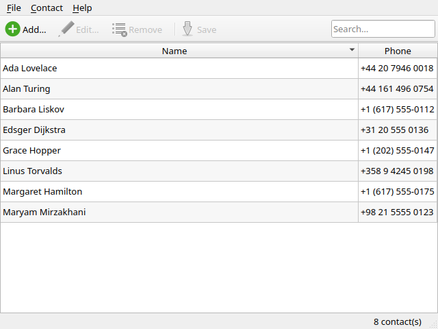

# qt-contacts

A small Qt 6 phone book, written as a **reference for learning Clean Architecture in C++**.



The app is intentionally simple: add, edit, remove, search, save and export contacts.
The point is *how* it is built. Every class has one job, the business rules don't know
Qt exists, and each layer has its own tests.

## Quick start

```bash
make deps    # install a C++17 compiler, CMake, Ninja and Qt 6 (Linux, macOS, Windows)
make run     # build and launch
make test    # build and run the unit tests
```

Prefer plain CMake?

```bash
cmake -S . -B build -G Ninja
cmake --build build
ctest --test-dir build --output-on-failure
./build/bin/qt-contacts --file /tmp/demo.dat
```

Requirements: CMake ≥ 3.16, a C++17 compiler, Qt ≥ 6.2 (the tests need Qt ≥ 6.3).

## Features

- Add, edit and remove contacts. Double-click a row to edit it.
- Search by name or phone, and sort by either column.
- Your input is checked: a name is required, phone numbers may only use digits and
  `+ - . ( )`, and the same number can't be stored twice (`+1 555-0100` and `1 (555) 0100`
  count as the same).
- Contacts are saved to a binary file, with an atomic write so a crash can't corrupt it.
- Export to CSV that opens in Excel, LibreOffice or Google Sheets.
- A `*` in the title means there are unsaved changes, and closing the window asks before
  discarding them.
- Keyboard shortcuts: `Ctrl+N` add, `Ctrl+E` edit, `Del` remove, `Ctrl+S` save,
  `F5` reload, `Ctrl+F` search.

## The architecture

The code is split into layers, one per folder in `src/`. **Dependencies point inward only.**
An inner layer never includes anything from an outer one.

```
 ┌──────────────────────────────────────────────────────────────┐
 │ main            composition root: creates and wires all parts │
 │  ┌────────────────────────────┐ ┌───────────────────────────┐ │
 │  │ ui         (Qt Widgets)    │ │ infrastructure  (Qt Core) │ │
 │  │ MainWindow, ContactDialog, │ │ BinaryContactRepository,  │ │
 │  │ ContactTableModel          │ │ CsvContactExporter        │ │
 │  └─────────────┬──────────────┘ └─────────────┬─────────────┘ │
 │                │ calls                        │ implements    │
 │  ┌─────────────▼──────────────────────────────▼─────────────┐ │
 │  │ application          (pure C++17, no Qt)                  │ │
 │  │ ContactService (use cases)                                │ │
 │  │ ContactRepository, ContactExporter (ports = interfaces)   │ │
 │  │  ┌─────────────────────────────────────────────────────┐ │ │
 │  │  │ domain           (pure C++17, no Qt)                 │ │ │
 │  │  │ Contact (entity), PhoneBook (aggregate), errors      │ │ │
 │  │  └─────────────────────────────────────────────────────┘ │ │
 │  └───────────────────────────────────────────────────────────┘ │
 └──────────────────────────────────────────────────────────────┘
```

| Layer | Folder | Knows about | Its job |
|---|---|---|---|
| **domain** | [src/domain](src/domain) | only the C++ standard library | The business rules: what a valid contact is, and the rules that cover the whole phone book |
| **application** | [src/application](src/application) | domain | The use cases (add, update, remove, load, save, export) and the *ports*, which are interfaces for the things it needs from outside |
| **infrastructure** | [src/infrastructure](src/infrastructure) | application, domain, Qt Core | *Adapters* that implement those ports with real files |
| **ui** | [src/ui](src/ui) | application, domain, Qt Widgets | Shows the data and turns clicks into use-case calls |
| **main** | [src/main](src/main) | everything | The *composition root*: picks the concrete adapters and wires them together |

The rule isn't only a convention: **CMake enforces it.** Each layer is its own static
library ([src/CMakeLists.txt](src/CMakeLists.txt)) and links only the layers it may use.
If you add `#include <QWidget>` to the domain, the build fails.

### Follow one click through the layers

What happens when you add "Ada" with phone `555 0100`:

1. **ui**: [MainWindow::addContact](src/ui/MainWindow.cpp) opens a
   [ContactDialog](src/ui/ContactDialog.cpp). When you press OK, the dialog calls the
   handler it was given, which calls `service_.add("Ada", "555 0100")`. The UI does no
   checking of its own.
2. **application**: [ContactService::add](src/application/ContactService.cpp) asks the
   domain to do the work, then marks the phone book unsaved and notifies its listeners.
3. **domain**: [PhoneBook::add](src/domain/PhoneBook.cpp) creates a
   [Contact](src/domain/Contact.cpp). The Contact constructor checks the name and phone
   and throws `ValidationError` if either is invalid. The PhoneBook then checks that no
   other contact has the same number.
4. If a rule is broken, the exception travels back up. The dialog shows its message and
   stays open so you can fix the input.
5. If it succeeds, the listener that `MainWindow` registered runs. It copies the new list
   into [ContactTableModel](src/ui/ContactTableModel.cpp), and the table redraws.

When you press **Save**, `ContactService::save` calls `repository_->save(...)`. The
service only knows the [ContactRepository](src/application/ContactRepository.h)
interface. That the data ends up in a binary file is decided in
[main.cpp](src/main/main.cpp), and nowhere else.

## Ideas to look for in the code

| Idea | Where | What to notice |
|---|---|---|
| **An entity that is always valid** | [Contact](src/domain/Contact.h) | The constructor and setters validate their input, so no other code has to check a `Contact` again. |
| **Aggregate** | [PhoneBook](src/domain/PhoneBook.h) | "No duplicate phone numbers" involves more than one contact, so it is checked by the collection, not by `Contact`. |
| **Strong exception guarantee** | [PhoneBook::update](src/domain/PhoneBook.cpp), [ContactService::load](src/application/ContactService.cpp) | The new state is built on the side and swapped in only after every check passes. A failure changes nothing. |
| **Ports and adapters** (dependency inversion) | [ContactRepository](src/application/ContactRepository.h) → [BinaryContactRepository](src/infrastructure/BinaryContactRepository.h) | The interface belongs to the inner layer. The outer layer implements it. |
| **Composition root** | [main.cpp](src/main/main.cpp) | The one place that names concrete classes. Swapping the storage is a one-line change here. |
| **Observer** | `ContactService::subscribe` | The service tells listeners that something changed without knowing that a UI exists. |
| **Humble UI** | [ContactDialog](src/ui/ContactDialog.h) | The dialog contains no rules. It shows whatever error the use case reports. |
| **Qt model/view** | [ContactTableModel](src/ui/ContactTableModel.h) + `QSortFilterProxyModel` | The model only exposes data. Sorting and filtering are done by a proxy model, without changing the model. |
| **Versioned binary format** | [BinaryContactRepository](src/infrastructure/BinaryContactRepository.h) | A magic number, a format version, a sanity limit on the count, and `QSaveFile` for atomic writes. Data loaded from disk is validated just like user input. |
| **Testing each layer on its own** | [tests/](tests) | Domain tests use no I/O. Application tests use in-memory *fakes* of the ports. Infrastructure tests use a temporary folder. The model is checked with `QAbstractItemModelTester`. |

## Try it yourself

These exercises each touch only one or two layers. That is the payoff of this structure.

1. **Store contacts in SQLite.** Write a `SqliteContactRepository` (Qt SQL) that
   implements `ContactRepository`, then change one line in `main.cpp`. Nothing in
   `domain/`, `application/` or `ui/` should need to change.
2. **Export vCard (`.vcf`)** with a new `ContactExporter` adapter.
3. **Add an email field.** Start in `Contact` (with its validation and tests), then
   follow the compiler errors outward through each layer.
4. **Build a command-line front end** (`qt-contacts-cli list|add|remove`) that reuses
   `ContactService` unchanged. It is just another outer layer.
5. **Add undo/redo** in the application layer. Can it be tested without any UI?

## File format

`contacts.dat` is written with `QDataStream`, in big-endian byte order, using stream
version `Qt_6_0`:

```
quint32  magic     0xAA55AA55
quint16  version   1
quint32  count
count × { qint64 id; QString name; QString phone }
```

By default it lives in the app-data folder. On Linux that is
`~/.local/share/Golfam/qt-contacts/contacts.dat`. Use `--file <path>` to open a different
one.

## Project layout

```
qt-contacts/
├── CMakeLists.txt          top-level build: C++17, Qt 6, tests on/off
├── Makefile                friendly wrapper around CMake (make help)
├── cmake/                  compiler warning flags
├── scripts/                install-deps-{linux,macos}.sh, install-deps-windows.ps1
├── src/
│   ├── domain/             Contact, PhoneBook, Errors
│   ├── application/        ContactService, ContactRepository, ContactExporter, Errors
│   ├── infrastructure/     BinaryContactRepository, CsvContactExporter
│   ├── ui/                 MainWindow, ContactDialog, ContactTableModel, Text
│   └── main/               main.cpp (composition root)
└── tests/                  one Qt Test executable per class
```

## Make targets

| Target | What it does |
|---|---|
| `make deps` | Install the toolchain and Qt 6 for your OS |
| `make` / `make build` | Configure and build (Release) |
| `make run` | Build and launch. Use `ARGS="--file /tmp/demo.dat"` to pass arguments. |
| `make test` | Build and run every unit test |
| `make debug` | Build and launch a Debug build |
| `make format` / `make format-check` | Format the sources with clang-format, or only check them |
| `make install` | Install under `PREFIX` (default `~/.local`) |
| `make clean` / `make distclean` | Remove object files, or every build directory |

Run `make help` for the full list. To use a Qt that CMake can't find on its own, pass
`QT_PREFIX=/path/to/Qt/6.x/gcc_64`.
